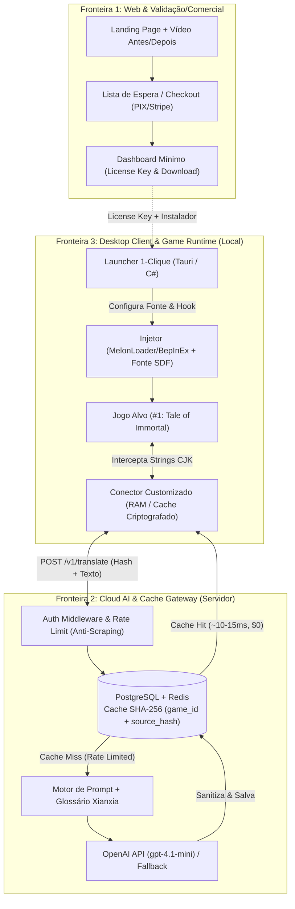

# AI All Games Translator — Contexto de Projeto & Diretrizes de Agente (`GEMINI.md` / `init.md`)

Este arquivo serve como **fonte única de verdade (Single Source of Truth)** para agentes de IA (Gemini, Claude, Codex, Antigravity) e desenvolvedores que atuam neste repositório. Leia este documento antes de propor arquiteturas, gerar código, criar roteiros ou tomar decisões de produto.

---

## 1. Visão Geral e Posicionamento do Produto

* **Produto:** Micro-SaaS e Ecossistema Open-Core de Tradução Contextual por IA para Jogos.
* **Nicho Inicial (Curado):** RPGs Asiáticos / Xianxia / Wuxia e Indies densos em texto na Steam.
  * **Jogo Âncora #1 (MVP):** *Tale of Immortal* (*Guigu Bahuang* / 鬼谷八荒 — Unity IL2CPP).
  * **Fila de Expansão:** *Wandering Sword*, *Hero's Adventure*, *The Matchless Kungfu*, *Amazing Cultivation Simulator*.
* **Proposta de Valor Central:**
  > *"Jogue RPGs chineses e japoneses traduzidos por IA com 1 clique — sem quadradinhos na fonte (`[]`), sem tradução literal sem sentido do Google e sem configurar arquivos."*
* **Duplo Objetivo do Projeto:**
  1. **Portfólio de Engenharia de Elite (Open-Core):** Demonstrar domínio em Engenharia de Sistemas (Hooks/DLL Injection em jogos Unity), Arquitetura de Nuvem (Cache Distribuído Content-Addressable de baixa latência), Engenharia de Prompt/IA (Glossários Contextuais CJK) e FinOps.
  2. **Micro-SaaS Validado:** Gerar receita recorrente focada em conveniência (1-clique + fonte SDF pronta + consistência canônica de termos de cultivo).

---

## 2. Diretrizes Estratégicas (Consolidadas da Avaliação Crítica)

Qualquer código, planejamento ou copy gerado para este projeto **DEVE** respeitar as seguintes restrições de negócio e engenharia identificadas em [`Avaliacao-critica.md`](./Avaliacao-critica.md):

1. **Validação Antes da Automação Total (Fase 0 Obrigatória):**
   * Não construa o Launcher completo, sistema de HWID complexo e múltiplos jogos antes de validar a demanda real via **Landing Page + Vídeo Comparativo Real + Lista de Espera com Pesquisa de Disposição a Pagar (R$ 19–29/mês)**.
2. **Foco em 1 Único Jogo Âncora no MVP:**
   * Toda a engenharia inicial deve resolver **100% do *Tale of Immortal*** (fluxo semi-manual de aquecimento de cache e curadoria de glossário antes de escalar para o 2º jogo).
3. **Diferenciação Contra Ferramentas Gratuitas (`XUnity`, `LunaTranslator`, `MTool`, `AiNiee`):**
   * O usuário técnico já consegue traduzir de graça configurando chaves e arquivos. Nosso produto **não compete por "ter tradução de IA"**, mas sim por:
     * **Zero-Friction (1 Clique)** para o jogador que não quer editar `.ini` ou trocar fontes manualmente.
     * **Glossário Canônico Curado** (consistência absoluta em *Qi Refining*, *Nascent Soul*, *Dantian*, *Dao*, seitas, técnicas e itens).
     * **Pacote de Fonte SDF Homologado** (`arialuni_sdf` + sanitização server-side contra quadradinhos `[]`).
4. **Mitigação de Risco Legal / ToS (Zona Cinzenta de Modding):**
   * **Nunca** vender ou anunciar como "Versão Oficial" ou comercializar ativos proprietários dos jogos.
   * Posicionar comercialmente como **Serviço de Cloud Cache, Glossário Contextual e Gerenciador de Localização (Modelo Híbrido / Open-Core)**.
   * Manter o hash `SHA-256` como chave primária de lookup no cache e separar estritamente código de integração genérica (público) de regras de negócio/glossários (privado).
5. **Realismo de Escopo Técnico:**
   * A blindagem client-side (traduções em RAM / AES por HWID) serve contra vazamento casual do arquivo `_AutoGeneratedTranslations.txt`, mas a segurança real contra prejuízo financeiro reside no **Backend (Fronteira 2)**: autenticação por token, Rate Limiting estrito de *Cache Miss* e Circuit Breaker para proteger os créditos da OpenAI API.

---

## 3. Arquitetura do Sistema (As 3 Fronteiras)

### Regras Técnicas por Fronteira

#### Fronteira 1: Web, Validação & Comercial
* **Fase 0 (Validação Rápida):** Carrd / Framer ou Astro + TailwindCSS, integrado a Tally.so / ConvertKit (captura de e-mail + pergunta de faixa de preço R$ 19–29/mês) e Plausible/Umami Analytics.
* **Fase 1 (Produto Comercial):** Next.js/Astro + Supabase (Auth/Licenças) + AbacatePay/Asaas (PIX) ou Stripe.

#### Fronteira 2: Cloud Backend & Motor de IA (`game-translator-cloud-api`)
* **Stack:** FastAPI (Python) ou Fastify/NestJS (Node.js) + PostgreSQL + Redis.
* **Contrato do Endpoint Principal (`POST /v1/translate`):**
  * Entrada: `{ "game_id": "guigubahuang", "source_hash": "<sha256>", "text": "炼气期", "target_lang": "pt-BR" }`
  * Fluxo:
    1. Valida `License Key` / Token de Sessão e `HWID`.
    2. Consulta cache por `(game_id, target_lang, source_hash)`. Se **Cache Hit**, retorna imediatamente sem acionar LLM.
    3. Se **Cache Miss**, verifica Rate Limit no Redis (ex.: máx. 40 *misses*/min por licença para evitar dreno de API por scraping).
    4. Injeta o **Glossário Contextual do `game_id`** no System Prompt e chama `gpt-4.1-mini`.
    5. Executa **Sanitização Server-Side** (normalização de caracteres, remoção de glifos que quebram fontes SDF legadas, preservação de variáveis/tags de UI do jogo como `{0}`, `<color=...>`).
    6. Persiste no PostgreSQL e retorna ao cliente.

#### Fronteira 3: Desktop Client & Conector (`game-translator-desktop-client`)
* **Stack:** Tauri (Rust + React) ou C# (.NET 8 WPF/Avalonia) + Conector C# (`CustomTranslate.dll` para XUnity/MelonLoader/BepInEx).
* **Requisitos Críticos:**
  * Instalação automática da fonte `arialuni_sdf` compatível com a versão do Unity IL2CPP do jogo.
  * Desativação do dump em texto aberto (`_AutoGeneratedTranslations.txt`), mantendo traduções em memória ou cache local ofuscado/criptografado.
  * Evolução gradual: substituir o protótipo `ProxyLLM.ps1` primeiro por um serviço local enxuto e depois pelo plugin integrado ao Launcher.

---

## 4. Glossário Base de Cultivo (Xianxia / *Tale of Immortal*)

Ao gerar prompts de tradução, vídeos demonstrativos, testes unitários ou seeds de banco de dados, mantenha **consistência estrita** nos termos abaixo (nunca traduzir literalmente como "Refinamento de Gás" ou "Bebê de Ouro"):

| Termo Original (ZH) | Pinyin | Termo Canônico (EN / Híbrido PT-BR) | Tradução PT-BR Contextual Aceita | Proibido (Erro de Tradução Literal) |
| :--- | :--- | :--- | :--- | :--- |
| 炼气 (炼气期) | Liàn Qì | *Qi Refining* | Refinamento de Qi | Refinamento de Ar / Gás |
| 筑基 (筑基期) | Zhù Jī | *Foundation Establishment* | Estabelecimento de Fundação | Construção de Base / Alicerce |
| 结晶 (结晶期) | Jié Jīng | *Qi Condensation / Core Formation* | Cristalização (Formação de Cristal) | Congelamento / Cristal |
| 金丹 (金丹期) | Jīn Dān | *Golden Core* | Núcleo Dourado (*Golden Core*) | Pílula de Ouro / Comprimido Dourado |
| 具灵 (具灵期) | Jù Líng | *Spirit Sight / Soul Formation* | Manifestação Espiritual | Ferramenta Espiritual |
| 元婴 (元婴期) | Yuán Yīng | *Nascent Soul* | Alma Nascente (*Nascent Soul*) | Bebê Original / Feto Primordial |
| 化神 (化神期) | Huà Shén | *Deity Transformation* | Transformação Divina | Química de Deus |
| 丹田 | Dān Tián | *Dantian* | *Dantian* (Centro de Energia) | Campo de Cinábrio / Campo Vermelho |
| 道 / 道心 | Dào / Dào Xīn | *Dao* / *Dao Heart* | *Dao* / Coração do *Dao* | Estrada / Coração da Rua |
| 灵气 | Líng Qì | *Spiritual Qi* | *Qi* Espiritual | Ar Inteligente / Gás Fantasma |
| 功法 / 武技 | Gōng Fǎ / Wǔ Jì | *Cultivation Technique / Martial Art* | Técnica de Cultivo / Arte Marcial | Método de Trabalho / Habilidade |
| 宗门 | Zōng Mén | *Sect* | Seita | Porta do Ancestral |

> **Regra de Prompt:** Preservar termos consagrados (*Qi*, *Dantian*, *Dao*, e opcionalmente os estágios em inglês ou português padronizado conforme preferência do perfil do glossário) e **jamais** alterar placeholders de código (`{0}`, `\n`, tags HTML/RichText da Unity).

---

## 5. Roteiros de Execução Ativos

### Fase 0: Validação de Demanda (Dias 1 a 7 — Prioridade Atual)
Baseado em [`Plano_Review.md`](./Plano_Review.md):
1. **Vídeo Comparativo (55–65s, 9:16 e 16:9):**
   * **Regra de Ouro:** Usar **gameplay real** de *Tale of Immortal* (nunca gerar vídeo de gameplay falso por IA).
   * **Estrutura:** `0-3s` Hook → `3-9s` Chinês puro → `9-18s` Google Tradutor quebrado → `18-28s` Cortes de erros/quadradinhos → `28-48s` Tradução limpa com IA + Glossário → `48-55s` 1-Clique → `55-63s` CTA Lista de Espera.
2. **Landing Page de Validação:**
   * Copy focada em dor real ("Sem quadradinhos. Sem tradução literal do Google. Sem configurar arquivos.").
   * Formulário de espera com pesquisa de preço: *"Se o tradutor custasse entre R$ 19 e R$ 29 por mês, você pagaria?"*
3. **Distribuição Orgânica:** Comunidades de *Tale of Immortal*, RPGs Chineses/Xianxia no Reddit, Discord, YouTube Shorts e TikTok.

### Fase 1 a 4: Engenharia & Construção do MVP (Raias de Desenvolvimento)
Baseado em [`Plano_Micro_SaaS_Tradutor_IA.md`](./Plano_Micro_SaaS_Tradutor_IA.md) e ajustado pelo realismo de [`Avaliacao-critica.md`](./Avaliacao-critica.md):
* **M1 (Core API & Cache Hit/Miss):** Backend FastAPI/Node + Postgres SHA-256 + Sanitização do `ProxyLLM.ps1` + Integração `gpt-4.1-mini` + Pacote de fonte SDF no *Tale of Immortal*.
* **M2 (Zero-Leak Client & Rate Limit):** Middleware de licença + Rate Limiting Redis + Substituição do script `.ps1` por cliente desktop/plugin enxuto.
* **M3 (Glossário, Seed & Checkout):** Pré-aquecimento de cache (*seed*) das strings mais comuns do Jogo #1 + Webhook de pagamento + Dashboard mínimo.
* **M4 (Open-Core Case Study):** Publicação do repositório público `realtime-game-llm-architecture` com benchmarks, diagramas e FinOps para portfólio.

---

## 6. Alocação Inteligente de Recursos de IA

| Recurso | Validade | Uso Determinado |
| :--- | :--- | :--- |
| **US$ 100 — OpenAI Codex** | 30 dias *(Prioridade Máxima)* | Geração de código pesado: scaffolding da API, banco de dados, plugin C#/Tauri, testes automatizados e scripts de build/empacotamento. |
| **Assinatura Gemini Pro** | Contínua | Arquitetura, revisão de segurança, geração de glossários Xianxia (ZH → PT-BR/EN), copywriting, roteiros e depuração de logs do MelonLoader/BepInEx. |
| **US$ 50 — OpenAI API** | 180 dias | **Exclusivo para Produção/Seed na Fronteira 2 (`gpt-4.1-mini`)**: tradução em lote do glossário e *seed* inicial do cache de *Tale of Immortal*. |

---

## 7. Mapa de Arquivos do Diretório

* [`README.md`](./README.md) — Documentação principal do projeto, arquitetura, roteiros e guia rápido.
* [`GEMINI.md`](./GEMINI.md) — Este documento de contexto e regras operacionais para agentes de IA (`init.md`).
* [`Plano_Micro_SaaS_Tradutor_IA.md`](./Plano_Micro_SaaS_Tradutor_IA.md) — Plano original de Produto, Arquitetura das 3 Fronteiras, Roadmap e Estratégia de GitHub Open-Core.
* [`Avaliacao-critica.md`](./Avaliacao-critica.md) — Análise de viabilidade, riscos legais/ToS, concorrência gratuita, unit economics e ajustes de rota.
* [`Plano_Review.md`](./Plano_Review.md) — Plano tático de validação (Fase 0): roteiro segundo a segundo do vídeo comparativo, copy da Landing Page e checklist de execução.

