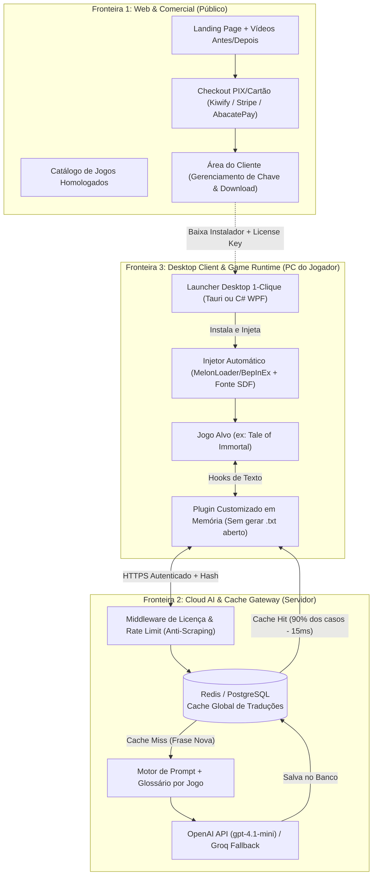

# Plano de Produto & Engenharia: Micro-SaaS de Tradução de Jogos por IA (Nicho Curado)

> [!IMPORTANT]
> **Por que este projeto é ouro para Portfólio + Renda Extra?**
> 95% dos portfólios de desenvolvedores têm apenas *CRUDs genéricos* ou *clones de Netflix*. Um projeto que integra **Engenharia de Sistemas (Injeção de DLL/Hooks em jogos)**, **Arquitetura de Nuvem (Cache Distribuído de Baixa Latência)**, **Engenharia de IA (Glossários Contextuais & Roteamento de LLMs)** e **Produto Real (Pagamentos & Proteção contra Engenharia Reversa)** coloca você imediatamente no topo de qualquer processo seletivo técnico, além de se pagar sozinho usando seus créditos gratuitos.

---

## 1. Posicionamento Estratégico (A "Terceira Opção")

Em vez de prometer "traduzir qualquer jogo do mundo" (o que geraria suporte infinito e quebras constantes), o produto nasce focado:

* **Nicho Inicial:** RPGs Asiáticos / Xianxia / Wuxia e Indies densos em texto na Steam (ex: *Tale of Immortal*, *Wandering Sword*, *Hero's Adventure*, *The Matchless Kungfu*, *Amazing Cultivation Simulator*).
* **Proposta de Valor:** *"Jogue RPGs chineses e japoneses traduzidos por IA com 1 clique — sem quadradinhos na fonte, sem tradução literal sem sentido do Google e sem configurar arquivos."*
* **Defesa Comercial:**
  1. **Catálogo Homologado:** O Launcher só libera a instalação para jogos que você já testou e validou a fonte.
  2. **Glossário Contextual de Cultivo/RPG:** Termos como *Qi Refining*, *Nascent Soul*, *Dantian* e *Dao* mantêm consistência canônica em todas as falas.
  3. **Cache em Memória (Anti-Leak):** Versão customizada do conector que não despeja o arquivo `.txt` completo de graça na pasta do usuário.

---

## 2. Divisão de Fronteiras do Sistema (Arquitetura)



---

### Detalhamento das 3 Fronteiras

#### Fronteira 1: Web App & Anunciação (Vitrine e Conversão)
* **Objetivo:** Converter visitantes em assinantes e entregar o acesso sem intervenção manual.
* **Stack Sugerida:** Next.js (ou Astro) + TailwindCSS + Supabase (Autenticação/Banco) + Gateway de Pagamento (AbacatePay/Asaas para PIX barato ou Stripe).
* **Páginas Essenciais:**
  1. **Home / Landing Page:** Headline forte, comparativo visual (Chinês -> Google Tradutor quebrado -> Sua IA com Glossário), vídeo de 20s mostrando o jogo rodando liso.
  2. **Catálogo de Jogos (`Status Board`):** Lista de jogos **Verificados** (100% funcionais), **Em Teste** e **Votação da Comunidade** (usuários votam no próximo jogo que querem suporte).
  3. **Dashboard Mínimo:** Onde o usuário vê sua `License Key`, status da assinatura, limite de uso e botão de download do Launcher.

#### Fronteira 2: Cloud Backend & Motor de IA (O Cérebro)
* **Objetivo:** Proteger sua chave da OpenAI, economizar 90% de tokens via cache e impedir abuso.
* **Stack Sugerida:** FastAPI (Python) ou Node.js (Fastify/NestJS) + PostgreSQL (com índice hash `SHA-256` da string original + ID do jogo) + Redis (Rate Limiting).
* **Regras de Negócio Críticas:**
  * **Lookup Ultra-Rápido:** Recebe `{ game_id: "guigubahuang", source_hash: "a9f3...", text: "炼气期" }`. Se o hash já existe no Postgres para aquele jogo, retorna em 10ms sem gastar 1 centavo da OpenAI.
  * **Injeção de Glossário:** Se não existe no cache, anexa o dicionário específico daquele `game_id` no System Prompt e chama o `gpt-4.1-mini`.
  * **Sanitização Server-Side:** O servidor já limpa caracteres incompatíveis e garante que a resposta volte pronta para a fonte do jogo.
  * **Proteção Anti-Dreno (Rate Limiting):** Limite de ex: 40 requisições de *Cache Miss* por minuto por chave de licença. Se um script tentar varrer 50.000 linhas em 5 minutos, o servidor bloqueia a chave temporariamente.

#### Fronteira 3: Software Baixável & Conector do Jogo (O Produto Local)
* **Objetivo:** Eliminar 100% do atrito técnico para o jogador leigo e dificultar a extração do banco de traduções.
* **Stack Sugerida:**
  * **Launcher:** **Tauri (Rust + React)** ou **C# (.NET 8 WPF/Avalonia)**. Tauri gera um executável minúsculo (~5MB), rápido e mais difícil de descompilar do que Electron.
  * **Injetor / Pacote por Jogo:** O Launcher baixa um pacote `.zip` do seu servidor contendo: `MelonLoader/BepInEx` na versão exata daquele jogo + o arquivo de fonte `arialuni_sdf` (fim dos quadradinhos `[]`) + o Plugin de tradução.
  * **Blindagem Básica contra "Pirata de R$ 20":**
    * Em vez de usar o endpoint HTTP aberto sem filtro e deixar o XUnity gravar tudo em `_AutoGeneratedTranslations.txt`, você compila um `CustomTranslate.dll` próprio para o XUnity (ou desativa o cache em disco no código do plugin) que exige o token de sessão ativo do seu Launcher e mantém as traduções do dia apenas em memória RAM (ou criptografadas em binário com AES atrelado ao Hardware ID da máquina).

---

## 3. Raias de Desenvolvimento (Roadmap de 4 Semanas)

Aproveitando que o seu **Codex ($100) vale por 30 dias** e sua **API ($50) vale por 180 dias**, o plano concentra a codificação pesada nas primeiras 3 semanas:

| Semana | Raia 1: Backend & IA | Raia 2: Desktop & Game Hook | Raia 3: Web & Comercial |
| :--- | :--- | :--- | :--- |
| **Semana 1**<br>*(Fundação)* | - Criar API (`POST /v1/translate`)<br>- Modelar tabela de Cache (`game_id`, `hash`, `zh_text`, `target_text`)<br>- Portar a limpeza de caracteres do `ProxyLLM.ps1` para o Backend<br>- Integrar `gpt-4.1-mini` ($50 API) | - Resolver em definitivo o pacote de fonte e sanitização no *Tale of Immortal*<br>- Criar protótipo de CLI/Serviço em Rust ou C# que substitui o script `.ps1` | - Definir nome do projeto e identidade visual<br>- Estruturar o repositório no GitHub |
| **Semana 2**<br>*(Blindagem & App)* | - Implementar validação de `License Key` e `HWID` (vínculo de máquina)<br>- Adicionar Rate Limiting (Redis/Memória) contra bots de scraping | - Construir a UI do Launcher Desktop (Login, Detectar Jogo, Botão "Ativar Tradução")<br>- Customizar o módulo de tradução para **não salvar `.txt` puro** na pasta do jogo | - Criar banco de usuários e licenças (Supabase)<br>- Começar a Landing Page em Next.js/Astro |
| **Semana 3**<br>*(Pagamentos & Catálogo)* | - Criar sistema de Glossário por jogo no banco de dados<br>- Pré-aquecer o cache (*seed*) traduzindo as frases mais comuns do jogo #1 | - Empacotar instalador Windows (`.msi` ou `.exe` com auto-update)<br>- Homologar um 2º jogo de teste para provar que a arquitetura escala | - Integrar Webhook de pagamento (pagou no PIX -> gera chave ativa no banco)<br>- Gravar vídeo comparativo para a Landing Page |
| **Semana 4**<br>*(Lançamento Beta)* | - Monitoramento de custos de tokens e latência<br>- Ajuste fino de prompts | - Testes com 5 a 10 jogadores reais (Beta Fechado)<br>- Correção de falsos-positivos ou erros de caminho da Steam | - Publicação do post de engenharia no LinkedIn / GitHub (Portfólio)<br>- Lançamento para comunidades de RPG/Xianxia |

---

## 4. Estratégia de GitHub: Portfólio vs. Segredo Comercial

Uma dúvida clássica de Micro-SaaS é: *"Como eu mostro isso no meu GitHub para recrutadores sem entregar o ouro para copiadores?"*

A resposta é a arquitetura **Open-Core / Vitrine Técnica**: você separa em repositórios privados (onde fica o produto real) e um repositório público de engenharia/arquitetura (ou SDK demonstrativo).

### Estrutura Recomendada de Repositórios

```text
📦 Sua-Organizacao-GitHub/
 ├── 🔒 [PRIVADO] game-translator-cloud-api      # Seu backend real, prompts, glossários e regras anti-fraude
 ├── 🔒 [PRIVADO] game-translator-desktop-client # Seu Launcher em Tauri/C# e o injetor customizado sem leak de .txt
 ├── 🔒 [PRIVADO] game-translator-web            # Sua Landing Page e Dashboard de vendas
 └── 🌍 [PÚBLICO] realtime-game-llm-architecture # O "Ímã de Recrutadores" (Case Study + Benchmark + Proxy Demo)
```

### O que colocar no Repositório PÚBLICO (Para brilhar no Portfólio/LinkedIn)
No repositório público (`realtime-game-llm-architecture`), você **não** coloca seu sistema de licenças nem seu anti-pirataria. Você publica um **Estudo de Caso de Engenharia de Alto Nível**:
1. **`README.md` Impecável:**
   * Diagramas de arquitetura (como o Mermaid acima).
   * Explicação de como você reduziu a latência de tradução de `1.200ms` (LLM puro) para `12ms` usando **Content-Addressable Caching (SHA-256)** + **Circuit Breaker**.
   * Explicação de como resolveu problemas reais de **Engenharia de Prompt** (anti-degeneração de CJK, sanitização de glifos Unicode para fontes bitmap legadas em motores Unity IL2CPP).
   * Métricas reais de **FinOps**: gráfico mostrando como o cache compartilhado reduziu o custo por jogador ativo em 88%.
2. **Código Demonstrativo (O Proxy Local Limpo):**
   * Uma versão limpa e bem documentada do proxy local (para quem quiser estudar integração com XUnity usando a própria chave de API), enquanto o link no topo do README diz: *"Não quer configurar código? Conheça nossa plataforma 1-Clique com Cache em Nuvem e Fontes Pré-Configuradas [Link para sua Landing Page]"*.
   * **Resultado:** Devs e recrutadores te dão *Star* no GitHub pela aula de arquitetura, e jogadores leigos que caírem lá clicam no link para assinar o seu produto pronto!

### Organização do GitHub Projects (Kanban)
Use o **GitHub Projects** vinculado aos repositórios privados com 4 colunas e *Labels* por fronteira:
* **Labels:** `fronteira:web`, `fronteira:cloud-api`, `fronteira:desktop`, `security:anti-leak`, `game-support`.
* **Milestones:**
  * `M1: Core API & Cache Hit/Miss`
  * `M2: Zero-Leak Desktop Injector`
  * `M3: Checkout & Web Landing`
  * `M4: Public Engineering Case Study`

---

## 5. Como Usar Seus Créditos de IA com Inteligência Máxima

| Recurso que você tem | Validade | Onde usar no plano |
| :--- | :--- | :--- |
| **US$ 100 - OpenAI Codex** | **30 dias** *(Urgente!)* | Use **exclusivamente para gerar código pesado nas Semanas 1 a 3**: scaffolding do backend FastAPI/Node, criação das telas do Launcher em Tauri/C#, testes automatizados e scripts de build. |
| **Assinatura Gemini Pro** | Contínua | Seu **Arquiteto Chefe e Revisor**: revisão de segurança, criação dos glossários de Xianxia (traduzir listas de 500 termos do chinês para EN/PT-BR para popular o banco antes do lançamento), copywriting da Landing Page e depuração de logs do MelonLoader. |
| **US$ 50 - OpenAI API** | **180 dias** | **Fundo de Produção do SaaS**: conecte essa chave apenas no seu servidor da **Fronteira 2** rodando `gpt-4.1-mini`. Esses $50 vão traduzir dezenas de milhões de tokens — o suficiente para colocar todo o script de *Tale of Immortal* e mais 10 jogos inteiros dentro do seu banco de dados de Cache sem você tirar R$ 1,00 do bolso. |
