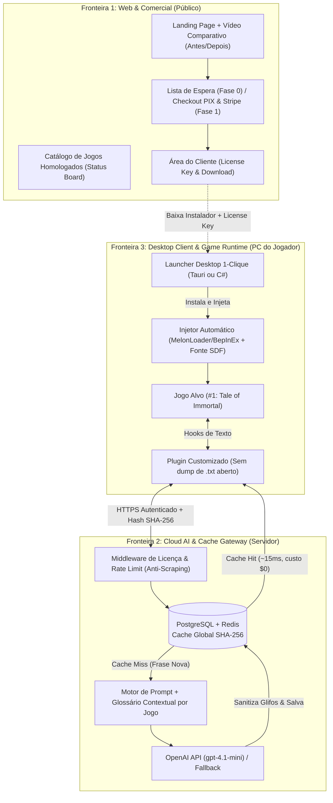

# AI All Games Translator (Xianxia & RPG Edition)

> **Tradução contextual por IA em 1 clique para RPGs Asiáticos / Xianxia densos em texto — com glossário canônico de cultivo, fontes SDF pré-configuradas (sem `[]`) e cache distribuído de baixa latência.**

---

## Sumário Executivo

Este projeto combina **Engenharia de Sistemas (Game Hooking & Font Patching)**, **Arquitetura de Nuvem (Content-Addressable Caching via SHA-256)** e **Engenharia de IA (Glossários Contextuais CJK)** em duas frentes complementares:
1. **Produto Micro-SaaS (Nicho Curado):** Focado inicialmente em *Tale of Immortal* (*Guigu Bahuang*) e RPGs chineses/japoneses na Steam que sofrem com traduções literais quebradas e problemas de renderização de fontes.
2. **Vitrine Técnica Open-Core (Portfólio de Engenharia):** Estudo de caso público demonstrando redução de latência (`1.200ms` → `~12ms` em *Cache Hit*) e economia de ~88% em custos de tokens (FinOps).

> [!IMPORTANT]
> **Para Agentes de IA (Gemini, Claude, Codex, Antigravity):** Leia o arquivo [`GEMINI.md`](./GEMINI.md) na raiz deste diretório antes de iniciar qualquer tarefa. Ele funciona como o `init.md` do projeto com todas as regras de arquitetura, restrições legais, glossário canônico e diretrizes de código.

---

## 1. Documentos Base do Projeto

| Arquivo | Descrição | Papel no Projeto |
| :--- | :--- | :--- |
| [`GEMINI.md`](./GEMINI.md) | Contexto de inicialização (`init.md`) para IAs e Devs | Regras de negócio, contratos de API, glossário base e restrições |
| [`Plano_Micro_SaaS_Tradutor_IA.md`](./Plano_Micro_SaaS_Tradutor_IA.md) | Plano de Produto & Engenharia | Arquitetura das 3 Fronteiras, Roadmap Técnico, Estratégia Open-Core e Uso de Créditos |
| [`Avaliacao-critica.md`](./Avaliacao-critica.md) | Análise Crítica de Viabilidade e Riscos | Avaliação realista (ToS/Legal, Concorrência Free, Prazos e Unit Economics) |
| [`Plano_Review.md`](./Plano_Review.md) | Playbook de Validação de Demanda (Fase 0) | Roteiro de vídeo comparativo (60s), Copy da Landing Page e Checklist de 4 dias |

---

## 2. Arquitetura do Sistema (3 Fronteiras)



---

## 3. Roteiro Integrado de Execução (Validar → Construir → Escalar)

Seguindo as recomendações da [Avaliação Crítica](./Avaliacao-critica.md), o projeto adota uma abordagem **Lean** dividida em **Fase 0 (Validação de Demanda)** seguida pelo **Desenvolvimento Técnico Focado em 1 Jogo Âncora**.

### Fase 0: Validação de Demanda e Intenção de Compra (Dias 1 a 7)
Antes de construir o Launcher completo e a automação multi-jogos, validar o interesse real do público:

1. **Produção do Vídeo Comparativo (55–65s | Formatos 9:16 e 16:9):**
   * **Regra:** Usar **footage real** do *Tale of Immortal* com overlay das traduções (não usar vídeo gerado por IA para o gameplay).
   * **Roteiro Segundo a Segundo (detalhado em [`Plano_Review.md`](./Plano_Review.md)):**
     * `00–03s`: Tela preta + Hook: *"Tale of Immortal… sem tradução de verdade"*
     * `03–09s`: Gameplay real em chinês puro: *"Você abre o jogo e vê isso."*
     * `09–18s`: Tradução Google/DeepL quebrada com setas nos erros: *"Google Tradutor faz isso."*
     * `18–28s`: Corte rápido de problemas: *"Termos de cultivo quebrados. Quadradinhos. Tradução literal sem alma."*
     * `28–48s`: Mesma cena traduzida com **IA + Glossário de Cultivo** (*Qi Refining*, *Nascent Soul*, *Dantian*, *Dao* consistentes).
     * `48–55s`: Resultado limpo: *"1 clique. Sem configurar arquivo. Sem quadradinhos."*
     * `55–63s`: CTA para Lista de Espera.
2. **Landing Page Enxuta + Pesquisa de Preço:**
   * **Stack Rápida:** Carrd.co / Framer / Astro + Tally.so + Plausible/Umami.
   * **Pergunta de Validação no Formulário:**
     > *"Se o tradutor custasse entre R$ 19 e R$ 29 por mês, você pagaria?"*
     > (`Sim, com certeza` | `Talvez, dependendo da qualidade` | `Só se fosse mais barato` | `Não pagaria`)
3. **Tração Inicial (Semana 2):**
   * Publicação diária de comparativos curtos (15–20s e 60s) em comunidades de *Tale of Immortal*, Reddit, Discord e TikTok/Shorts com links rastreados por UTM.

---

### Fase 1: Fundação Técnica & Homologação do Jogo #1 (*Tale of Immortal*)
* **Backend & IA (Fronteira 2):**
  * Criar endpoint `POST /v1/translate` (FastAPI ou Node.js).
  * Modelar tabela de Cache Content-Addressable no PostgreSQL (`game_id`, `source_hash` SHA-256, `zh_text`, `target_text`, `target_lang`).
  * Portar a lógica de sanitização de caracteres do `ProxyLLM.ps1` para o servidor.
  * Integrar `gpt-4.1-mini` com o glossário inicial de Xianxia.
* **Game Runtime (Fronteira 3):**
  * Fechar pacote homologado de fonte SDF (`arialuni_sdf`) + sanitização para eliminar 100% dos quadradinhos `[]` no *Tale of Immortal* (Unity IL2CPP).
  * Substituir o script `.ps1` por um serviço/conector compilado em Rust ou C#.

### Fase 2: Proteção de Custos, Anti-Leak & Launcher MVP
* **Backend & Segurança:**
  * Validação de `License Key` e vínculo básico de dispositivo (`HWID`).
  * Implementar **Rate Limiting no Redis** para *Cache Misses* (ex.: máx. 40 *misses*/min por chave) protegendo os créditos da OpenAI contra scripts de scraping.
* **Desktop Client:**
  * Interface mínima do Launcher Desktop (Tauri ou C# WPF): Login com Chave → Detectar *Tale of Immortal* → Botão **"Ativar Tradução 1-Clique"**.
  * Configurar o plugin conector para operar em memória/cache binário sem despejar `_AutoGeneratedTranslations.txt` puro na pasta do jogo.

### Fase 3: Pré-Aquecimento de Cache (*Seed*) & Comercialização
* **Seed do Jogo #1:**
  * Traduzir previamente as strings e diálogos mais frequentes de *Tale of Immortal* usando o fundo de US$ 50 da OpenAI API para garantir >85% de *Cache Hit* já no dia do lançamento.
* **Fluxo Comercial (Fronteira 1):**
  * Integrar webhook de pagamento (PIX via AbacatePay/Asaas ou Stripe) gerando a `License Key` automaticamente no banco (Supabase/Postgres).

### Fase 4: Beta Fechado & Vitrine Open-Core (Portfólio)
* **Beta com Jogadores Reais:** Testes com 5–10 usuários da lista de espera, monitorando custo por usuário ativo, latência e falhas de caminho da Steam.
* **Repositório Público (`realtime-game-llm-architecture`):**
  * Publicar estudo de caso técnico com arquitetura Mermaid, benchmarks de cache SHA-256, sanitização Unicode para Unity IL2CPP e proxy local demonstrativo (sem expor o sistema de licenças nem os glossários curados).

---

## 4. Gestão de Riscos e Decisões de Produto

| Risco Identificado | Impacto | Estratégia de Mitigação Adotada |
| :--- | :--- | :--- |
| **Ferramentas Gratuitas Existentes** (`XUnity`, `LunaTranslator`, `MTool`) | Médio/Alto | Focar no público que **não quer configurar** fontes, endpoints e arquivos `.ini`, vendendo **conveniência 1-clique + glossário curado Xianxia**. |
| **ToS / EULA de Jogos Comerciais** | Alto | Não vender mods como produto oficial do jogo; posicionar como **serviço de nuvem (Cache + Glossário Contextual)** e considerar modelo **Open-Core Híbrido** (conector aberto + nuvem/glossário premium). |
| **Complexidade de Manutenção por Jogo (Unity IL2CPP)** | Alto | **Não prometer "qualquer jogo"**. Manter catálogo estritamente homologado, começando exclusivamente por *Tale of Immortal* até estabilizar os unit economics. |
| **Dreno de Créditos da API (Scraping)** | Crítico | Rate Limiting agressivo por `License Key` apenas em *Cache Misses* + Circuit Breaker financeiro diário no backend. |

---

## 5. Estrutura Planejada de Repositórios

```text
📦 Organizacao-GitHub/
 ├── 🔒 [PRIVADO] game-translator-cloud-api        # FastAPI/Node, Prompts, Glossários Xianxia, Cache SHA-256 & Rate Limit
 ├── 🔒 [PRIVADO] game-translator-desktop-client   # Launcher 1-Clique (Tauri/C#), Pacote SDF e Conector sem leak de .txt
 ├── 🔒 [PRIVADO] game-translator-web              # Landing Page, Status Board de Jogos Homologados e Dashboard de Licenças
 └── 🌍 [PÚBLICO] realtime-game-llm-architecture   # Case Study de Engenharia, Benchmarks, FinOps e Proxy Local Demo
```

